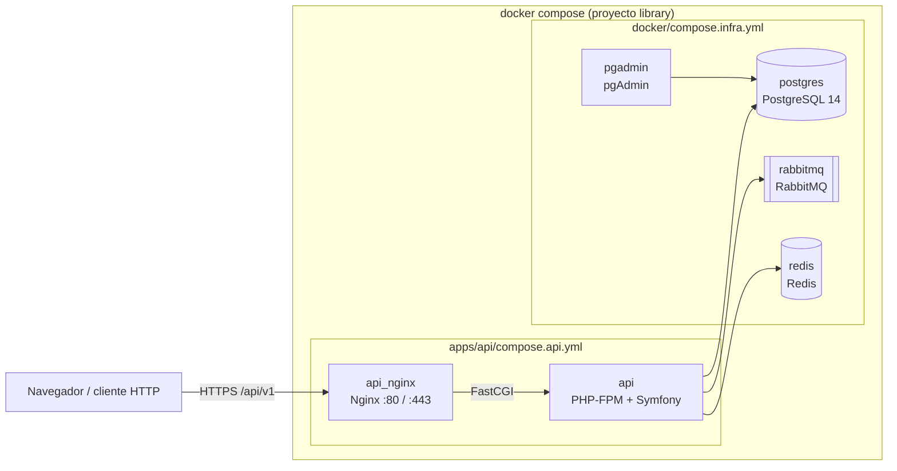

# Library

Monorepo de Library, un catálogo bibliográfico. Contiene las aplicaciones en `apps/`, la infraestructura compartida en `docker/` y un único `docker-compose.yml` en la raíz que levanta todo junto.

| App | Carpeta | Descripción |
|---|---|---|
| API | [apps/api](apps/api) | API REST en Symfony 7.4 y PHP 8.4: autores, libros, ediciones, editoriales y países. Ver su [README](apps/api/README.md). |
| Web | `apps/web` | Frontend en Next.js. Todavía no existe; se creará en un plan aparte. |

## Arquitectura



[docker-compose.yml](docker-compose.yml) no define servicios: incluye (`include`) un fichero de infraestructura compartida y otro por app. Cada fichero incluido resuelve sus rutas relativas desde su propia carpeta. Todos forman el proyecto `library`, así que comparten red y los volúmenes conservan sus nombres (`library_amqp-data`, `library_php_socket`). Los datos de PostgreSQL y Redis están en `./postgres_data` y `./redis_data`.

| Servicio | Fichero | Puertos en el host | Función |
|---|---|---|---|
| `api` | [apps/api/compose.api.yml](apps/api/compose.api.yml) | Ninguno | PHP-FPM con la API |
| `api_nginx` | [apps/api/compose.api.yml](apps/api/compose.api.yml) | 80, 443 | Servidor web de la API (certificado autofirmado en 443) |
| `postgres` | [docker/compose.infra.yml](docker/compose.infra.yml) | 5432 | PostgreSQL 14 con SSL |
| `rabbitmq` | [docker/compose.infra.yml](docker/compose.infra.yml) | 5672, 15672 | RabbitMQ con el plugin de gestión |
| `redis` | [docker/compose.infra.yml](docker/compose.infra.yml) | 6379 | Redis con contraseña `REDIS_PASSWORD` |
| `pgadmin` | [docker/compose.infra.yml](docker/compose.infra.yml) | 5050 | pgAdmin 4 |

`docker/compose.infra.yml` contiene además el stack de Elastic (Elasticsearch, Kibana, Filebeat, Metricbeat, APM) comentado; no se arranca.

## Requisitos previos

- Docker con Docker Compose 2.20 o superior (`docker compose version`), necesario para `include`.
- `make`.
- Puertos libres en el host: 80, 443, 5432, 5050, 5672, 15672 y 6379.

## Configuración

Hay dos ficheros `.env`, los dos ignorados por git:

| Fichero | Lo lee | Plantilla | Contenido |
|---|---|---|---|
| `.env` (raíz) | Docker Compose | [.env.dist](.env.dist) | `USER_ID`, credenciales con las que arrancan Postgres, Redis y RabbitMQ, `COVERAGE_DRIVER` |
| `apps/api/.env` | Symfony | [apps/api/.env.dist](apps/api/.env.dist) | Configuración de la API; ver su [README](apps/api/README.md#configuración) |

```bash
cp .env.dist .env
cp apps/api/.env.dist apps/api/.env
```

Las credenciales de Postgres, Redis y RabbitMQ deben coincidir en los dos ficheros. Dentro de Docker, los hosts de `apps/api/.env` son los nombres de los servicios: `postgres`, `rabbitmq` y `redis`. Si una contraseña del `.env` de la raíz contiene `$`, escríbela con `$$` o entre comillas simples.

## Arranque con Docker

Desde la raíz del repositorio:

```bash
# 1. Configuración (ver arriba)
cp .env.dist .env && cp apps/api/.env.dist apps/api/.env

# 2. Construir las imágenes y arrancar en segundo plano
make start                 # equivale a: make build && make up

# 3. Preparar la API: esquema y países, claves JWT
make api-restore
make api-console c=lexik:jwt:generate-keypair

# 4. Ver los logs / parar (conserva los datos)
make logs
make stop
```

La API queda en `https://localhost/api/v1`. Para crear un usuario y obtener un token, sigue el [README de la API](apps/api/README.md#crear-un-usuario-y-obtener-un-token).

Sin `make`, usa `docker compose` desde la raíz pasando tu usuario: `USER_ID=$(id -u) GROUP_ID=$(id -g) docker compose up --detach`. `make down` elimina los contenedores pero no los datos de `./postgres_data` ni `./redis_data`. No uses `docker compose down -v` salvo que quieras **borrar también el volumen de RabbitMQ (`amqp-data`)**.

## Comandos

El [Makefile](Makefile) de la raíz gestiona Docker. Cada app tiene su propio Makefile, al que se llega con el prefijo de la app: `make api-<objetivo>` ejecuta `<objetivo>` de [apps/api/Makefile](apps/api/Makefile).

| Comando | Descripción |
|---|---|
| `make help` | Lista los objetivos de la raíz |
| `make start` | Construye las imágenes y arranca los contenedores |
| `make build` / `make up` / `make stop` / `make down` | Construye, arranca, para o elimina los contenedores |
| `make logs` / `make ps` | Logs en directo / estado de los contenedores |
| `make pgadmin` / `make rabbit` | Abre pgAdmin o la gestión de RabbitMQ en el navegador |
| `make api-help` | Lista los objetivos de la API (`api-test`, `api-lint`, `api-composer`…) |

## Estructura del repositorio

```text
.
├── apps/
│   └── api/                    # API Symfony: código, Dockerfile, compose.api.yml, Makefile, .env.dist
├── docker/
│   ├── compose.infra.yml       # postgres, rabbitmq, redis, pgadmin (y Elastic comentado)
│   ├── postgres/  rabbit/  redis/  elastic/
├── .github/workflows/
│   └── api.yml                 # CI de la API
├── docker-compose.yml          # Punto de entrada: include de infra y de cada app
├── .env.dist                   # Variables de Docker Compose
├── Makefile                    # Ciclo de Docker y delegación api-*
└── LICENSE
```

## CI

Cada app tiene su propio workflow, que solo se ejecuta cuando cambian sus ficheros. [api.yml](.github/workflows/api.yml) se lanza en `master` y en los pull requests que tocan `apps/api/`, `docker/`, `docker-compose.yml` o el propio workflow; también se puede lanzar a mano desde la pestaña Actions. No hay checks obligatorios en `master`. Ninguna imagen se publica en un registro.

## Licencia

MIT, ver [LICENSE](LICENSE).
