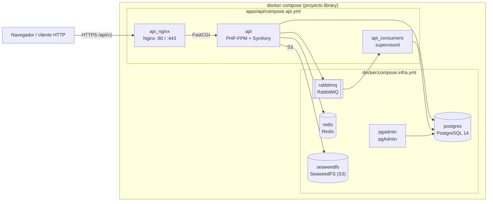

# Library

Monorepo de Library, un catálogo bibliográfico. Contiene las aplicaciones en `apps/`, la infraestructura compartida en `docker/` y un único `docker-compose.yml` en la raíz que levanta todo junto.

| App | Carpeta | Descripción |
|---|---|---|
| API | [apps/api](apps/api) | API REST en Symfony 7.4 y PHP 8.4: autores, libros, ediciones, editoriales y países. Ver su [README](apps/api/README.md). |
| Web | `apps/web` | Frontend en Next.js. Todavía no existe; se creará en un plan aparte. |

## Arquitectura



[docker-compose.yml](docker-compose.yml) no define servicios: incluye (`include`) un fichero de infraestructura compartida y otro por app. Cada fichero incluido resuelve sus rutas relativas desde su propia carpeta. Todos forman el proyecto `library`, así que comparten red y los volúmenes conservan sus nombres (`library_amqp-data`, `library_php_socket`). Los datos de PostgreSQL y Redis están en `./postgres_data` y `./redis_data`; los ficheros de SeaweedFS, en el volumen `library_seaweedfs_data`.

| Servicio | Fichero | Puertos en el host | Función |
|---|---|---|---|
| `api` | [apps/api/compose.api.yml](apps/api/compose.api.yml) | Ninguno | PHP-FPM con la API |
| `api_consumers` | [apps/api/compose.api.yml](apps/api/compose.api.yml) | Ninguno | Consumidores de RabbitMQ: supervisord con un proceso por suscriptor |
| `api_nginx` | [apps/api/compose.api.yml](apps/api/compose.api.yml) | 80, 443 | Servidor web de la API (certificado autofirmado en 443) |
| `postgres` | [docker/compose.infra.yml](docker/compose.infra.yml) | 5432 | PostgreSQL 14 con SSL |
| `rabbitmq` | [docker/compose.infra.yml](docker/compose.infra.yml) | 5672, 15672 | RabbitMQ con el plugin de gestión |
| `redis` | [docker/compose.infra.yml](docker/compose.infra.yml) | 6379 | Redis con contraseña `REDIS_PASSWORD` |
| `pgadmin` | [docker/compose.infra.yml](docker/compose.infra.yml) | 5050 | pgAdmin 4 |
| `seaweedfs` | [docker/compose.infra.yml](docker/compose.infra.yml) | Ninguno | Almacenamiento S3 de los recursos de las ediciones. Crea el bucket `S3_BUCKET` al arrancar; los ficheros solo se descargan a través de la API |

El stack de observabilidad (Elastic) está en [docker/compose.elastic.yml](docker/compose.elastic.yml), en el perfil `elastic`: `make up` no lo arranca. Ver [Observabilidad](#observabilidad).

## Requisitos previos

- Docker con Docker Compose 2.20 o superior (`docker compose version`), necesario para `include`.
- `make`.
- Puertos libres en el host: 80, 443, 5432, 5050, 5672, 15672 y 6379.

## Configuración

Hay dos ficheros `.env`, los dos ignorados por git:

| Fichero | Lo lee | Plantilla | Contenido |
|---|---|---|---|
| `.env` (raíz) | Docker Compose | [.env.dist](.env.dist) | `USER_ID`, credenciales con las que arrancan Postgres, Redis y RabbitMQ, `COVERAGE_DRIVER` |
| `apps/api/.env` | Symfony | [apps/api/.env.dist](apps/api/.env.dist) | Configuración de la API; ver su [README](apps/api/README.md#configuración) |

```bash
cp .env.dist .env
cp apps/api/.env.dist apps/api/.env
```

Las credenciales de Postgres, Redis, RabbitMQ y S3 (`S3_ACCESS_KEY`, `S3_SECRET_KEY`, `S3_BUCKET`) deben coincidir en los dos ficheros. Dentro de Docker, los hosts de `apps/api/.env` son los nombres de los servicios: `postgres`, `rabbitmq` y `redis`, y `S3_ENDPOINT=http://seaweedfs:8333`. Si una contraseña del `.env` de la raíz contiene `$`, escríbela con `$$` o entre comillas simples.

## Arranque con Docker

Desde la raíz del repositorio:

```bash
# 1. Configuración (ver arriba)
cp .env.dist .env && cp apps/api/.env.dist apps/api/.env

# 2. Construir las imágenes y arrancar en segundo plano
make start                 # equivale a: make build && make up

# 3. Preparar la API: esquema y países, claves JWT
make api-restore
make api-console c=lexik:jwt:generate-keypair

# 4. Ver los logs / parar (conserva los datos)
make logs
make stop
```

La API queda en `https://localhost/api/v1`. Para crear un usuario y obtener un token, sigue el [README de la API](apps/api/README.md#crear-un-usuario-y-obtener-un-token).

### Actualizar una base de datos existente

`make api-restore` carga el esquema completo en una base de datos vacía. Los cambios de esquema posteriores están en [apps/api/migrations/updates/](apps/api/migrations/updates); aplica cada uno una vez, en orden:

```bash
make api-migrate f=migrations/updates/2026-11-04-edition-resources.sql
```

Sin `make`, usa `docker compose` desde la raíz pasando tu usuario: `USER_ID=$(id -u) GROUP_ID=$(id -g) docker compose up --detach`. `make down` elimina los contenedores pero no los datos de `./postgres_data` ni `./redis_data`. No uses `docker compose down -v` salvo que quieras **borrar también el volumen de RabbitMQ (`amqp-data`)**.

## Comandos

El [Makefile](Makefile) de la raíz gestiona Docker. Cada app tiene su propio Makefile, al que se llega con el prefijo de la app: `make api-<objetivo>` ejecuta `<objetivo>` de [apps/api/Makefile](apps/api/Makefile).

| Comando | Descripción |
|---|---|
| `make help` | Lista los objetivos de la raíz |
| `make start` | Construye las imágenes y arranca los contenedores |
| `make build` / `make up` / `make stop` / `make down` | Construye, arranca, para o elimina los contenedores |
| `make logs` / `make ps` | Logs en directo / estado de los contenedores |
| `make pgadmin` / `make rabbit` | Abre pgAdmin o la gestión de RabbitMQ en el navegador |
| `make api-help` | Lista los objetivos de la API (`api-test`, `api-lint`, `api-composer`…) |
| `make elastic-up` / `make elastic-down` | Arranca todo más el stack de Elastic / para y elimina solo el stack (conserva sus datos) |
| `make kibana` / `make elastic-logs` | Abre Kibana / logs en directo del stack |
| `make elastic-ca` | Copia la CA local a `var/elastic-ca.crt`, para confiar en ella en el navegador |
| `make elastic-export` | Guarda los dashboards tal como están en Kibana en `docker/elastic/kibana/library.ndjson` |
| `make elastic-reset` | Borra todos los datos de Elasticsearch (pide confirmación) |

## Observabilidad

El perfil `elastic` añade Elasticsearch y Kibana 9 con seguridad y TLS, un APM Server, Filebeat y Metricbeat. Todos usan una CA local que crea el servicio `elastic_setup`.

| Servicio | Puerto en el host | Función |
|---|---|---|
| `elasticsearch` | 127.0.0.1:9200 | Almacena trazas, logs, métricas y alertas. Cada dato se guarda 7 días (`ELASTIC_RETENTION`) |
| `kibana` | 127.0.0.1:5601 | Interfaz: `https://localhost:5601`, usuario `elastic` y `ELASTIC_PASSWORD` |
| `apm_server` | 127.0.0.1:8200 | Recibe las trazas OpenTelemetry de `api` y `api_consumers` |
| `filebeat` | Ninguno | Envía los logs de la API (JSON ECS con `trace.id`), nginx y PostgreSQL |
| `metricbeat` | Ninguno | Métricas de contenedores, PostgreSQL, RabbitMQ, PHP-FPM, nginx, Redis y Elasticsearch |
| `elastic_setup`, `kibana_setup` | Ninguno | Se ejecutan una vez en cada arranque: certificados, usuarios y retención; dashboards y alertas |

### Arrancarlo

1. Rellena en el `.env` de la raíz las variables de Elastic de [.env.dist](.env.dist): contraseñas, `KIBANA_ENCRYPTION_KEY` (32 caracteres o más) y `APM_SECRET_TOKEN` (solo letras y números).
2. Ejecuta `make build`. Las imágenes de la API, nginx y PostgreSQL llevan cambios de observabilidad.
3. Ejecuta `make elastic-up`.
4. Ejecuta `make kibana`.

El primer arranque tarda unos minutos. Para no ver avisos de certificado en el navegador, importa como CA de confianza el fichero que crea `make elastic-ca`.

### Qué hay en Kibana

- **Dashboards** (Analytics → Dashboards, los que empiezan por "Library ·"):
  - **Library · API**: peticiones, latencia y errores por endpoint, y las consultas SQL.
  - **Library · Dominio**: mensajes procesados por cada consumidor, duplicados descartados, colas y consumidores de RabbitMQ, mensajes del bus y llamadas a Google Books.
  - **Library · Infraestructura**: CPU y memoria por contenedor, PHP-FPM, nginx, PostgreSQL, Redis y disco de Elasticsearch.
  - **Library · Errores y logs**: errores de la API, nginx y PostgreSQL, y los últimos logs con su `trace.id`.
  - También están los dashboards integrados de Filebeat y Metricbeat (`[Filebeat …]`, `[Metricbeat …]`).
- **APM** (Observability → APM): servicios `library-api` y `library-consumers`. Una petición que publica un evento comparte la traza con el consumidor que lo procesa.
- **Alertas** (Stack Management → Rules, etiqueta `library`). Cada alerta se escribe en el índice `library-alerts`, que puedes consultar en Discover:

| Regla | Condición |
|---|---|
| `library-api-error-rate` | Más de un 5 % de peticiones fallidas en 5 minutos |
| `library-api-latency` | Latencia p95 de la API por encima de 1 s en 5 minutos |
| `library-queue-backlog` | Más de 100 mensajes en una cola durante 10 minutos |
| `library-queue-no-consumers` | Una cola `colybri.library.*` sin consumidores durante 2 minutos |
| `library-google-books` | Una llamada a Google Books que falla o tarda más de 3 s |
| `library-es-disk` | Disco de Elasticsearch por encima del 85 % |

### Cambiar dashboards y alertas

- **Dashboards.** Edítalos en Kibana, ejecuta `make elastic-export` y haz commit de [docker/elastic/kibana/library.ndjson](docker/elastic/kibana/library.ndjson). `kibana_setup` los importa en cada arranque y sobrescribe los cambios que no se hayan exportado.
- **Alertas.** Están en [docker/elastic/kibana/rules/](docker/elastic/kibana/rules). Edita el JSON y vuelve a ejecutar `make elastic-up`. `kibana_setup` borra las reglas y las crea de nuevo.

## Estructura del repositorio

```text
.
├── apps/
│   └── api/                    # API Symfony: código, Dockerfile, compose.api.yml, Makefile, .env.dist
├── docker/
│   ├── compose.infra.yml       # postgres, rabbitmq, redis, pgadmin, seaweedfs
│   ├── compose.elastic.yml     # Elastic (perfil elastic): ES, Kibana, APM, Filebeat, Metricbeat
│   ├── elastic/                # setup, configuración de los Beats y del APM Server, dashboards y alertas
│   ├── postgres/  rabbit/  redis/  seaweedfs/
├── .github/workflows/
│   ├── api.yml                 # CI de la API
│   └── elastic.yml             # CI del stack de Elastic: prueba de punta a punta
├── docker-compose.yml          # Punto de entrada: include de infra y de cada app
├── .env.dist                   # Variables de Docker Compose
├── Makefile                    # Ciclo de Docker y delegación api-*
└── LICENSE
```

## CI

Cada app tiene su propio workflow, que solo se ejecuta cuando cambian sus ficheros. [elastic.yml](.github/workflows/elastic.yml) arranca todo con el perfil `elastic` y lo comprueba de punta a punta: la traza de un `POST` hasta el consumidor, la subida y descarga de un recurso de una edición a través de SeaweedFS, logs, métricas, alertas y dashboards. Las capturas de los dashboards quedan en los artefactos de la ejecución. [api.yml](.github/workflows/api.yml) se lanza en `master` y en los pull requests que tocan `apps/api/`, `docker/`, `docker-compose.yml` o el propio workflow; también se puede lanzar a mano desde la pestaña Actions. No hay checks obligatorios en `master`. Ninguna imagen se publica en un registro.

## Licencia

MIT, ver [LICENSE](LICENSE).
